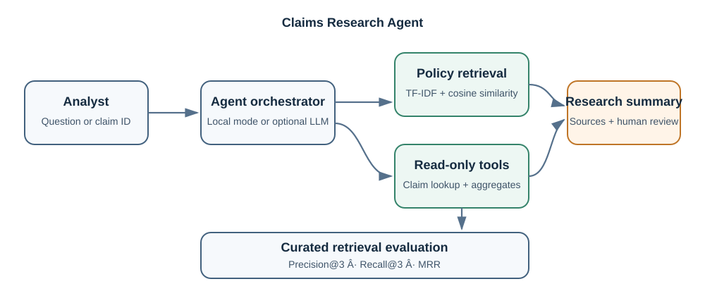
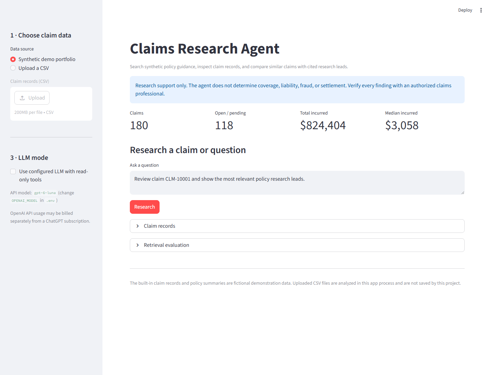
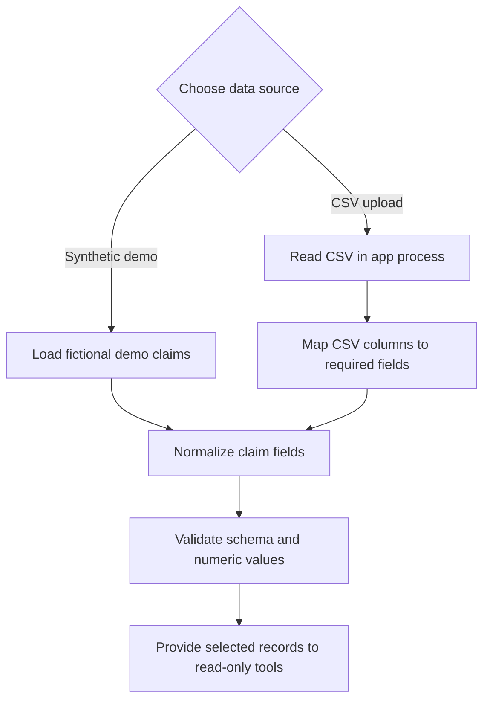
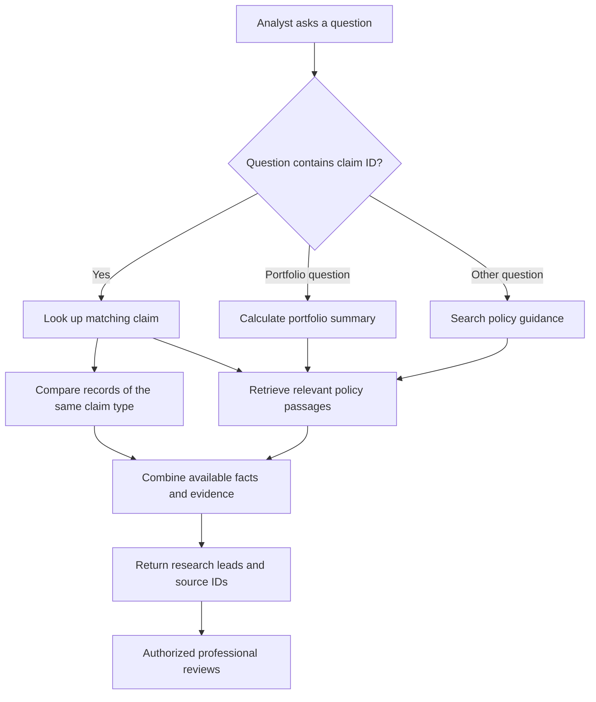
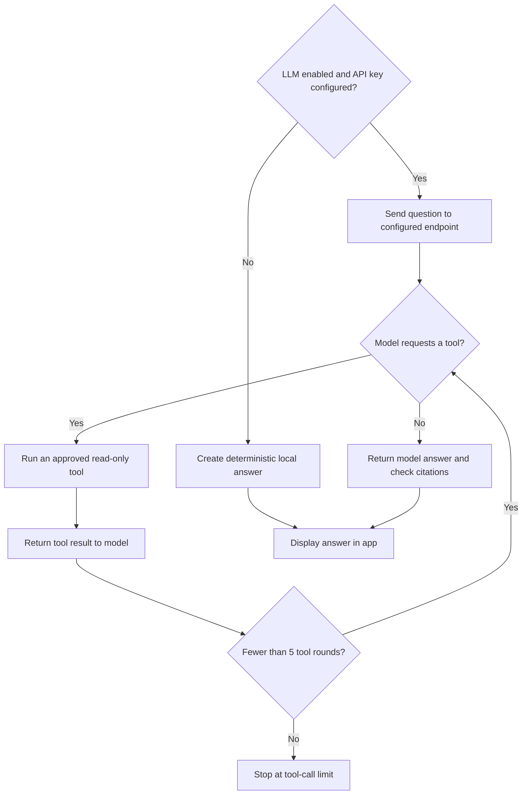

# Insurance Claims Research Agent

A local research assistant that searches synthetic policy guidance and analyzes structured claims records. It returns source references and descriptive comparisons for review by an authorized claims professional.

> This is a portfolio demonstration using fictional claims and synthetic policy summaries. It does not decide coverage, liability, fraud, or settlement.

## Problem

Claims analysts often need to locate relevant policy wording and review claim facts across multiple records. This project demonstrates a small, auditable workflow that combines text retrieval with read-only structured-data tools and keeps a human reviewer responsible for decisions.

## Features

- Deterministic synthetic claims dataset and a separate, safe CSV example.
- Local TF-IDF vector retrieval over synthetic policy and handling guidance.
- Claim lookup, claim-type comparison, and portfolio summary tools.
- Cited policy research leads and descriptive claim statistics.
- Optional LLM tool calling; local mode works without an API key.
- CSV upload with sidebar field mapping and basic numeric validation.
- Curated retrieval evaluation reporting Precision@3, Recall@3, and MRR.

## Technology

Python 3.11+, Streamlit, pandas, NumPy, scikit-learn, Python `unittest`, and the OpenAI Responses API through Python's standard-library HTTP client (optional). The application does not need the OpenAI SDK to run.

## Architecture



The Streamlit UI passes a question and selected claims to `ClaimsResearchAgent`. `PolicyRetriever` builds a TF-IDF index and ranks policy passages with cosine similarity. The agent's read-only tools provide record lookup and aggregate summaries. The optional LLM can select only these tools; local mode provides deterministic summaries. The evaluation module checks a curated set of retrieval questions against expected policy source IDs.

See [the detailed architecture and limitations](docs/claims-agent-architecture.md).

## App screenshot

The screenshot shows the app using its fictional synthetic demo portfolio.



## Workflow diagrams

### End-to-end flow

```mermaid
flowchart LR
    Analyst[Claims analyst] -->|Select data and ask a question| App[Streamlit app]
    Demo[Synthetic demo claims] --> Data[Normalize and validate claims]
    CSV[Uploaded CSV] --> Map[Map required fields]
    Map --> Data
    App -->|Selected claims| Data
    Data --> Tools[Read-only claim tools]
    Docs[Synthetic policy guidance] --> Index[TF-IDF policy index]
    App --> Agent[Claims research agent]
    Agent --> Tools
    Agent --> Index
    Tools --> Facts[Claim facts and aggregates]
    Index --> Evidence[Ranked policy research leads]
    Facts --> Answer[Research summary with source IDs]
    Evidence --> Answer
    Answer --> Review[Human review]
    Agent -. Optional, when enabled .-> API[Configured LLM API]
    API -. Tool requests .-> Agent
    Eval[Curated evaluation queries] --> Metrics[Precision@3, Recall@3, MRR]
    Index --> Metrics
```

### Step 1: Select and prepare claim data



### Step 2: Research a question



### Step 3: Optional LLM tool-calling path



### Step 4: Evaluate policy retrieval

```mermaid
flowchart LR
    Cases[Eight curated questions and expected source IDs] --> Search[Retrieve top 3 policy passages per question]
    Index[TF-IDF policy index] --> Search
    Search --> Compare[Compare retrieved IDs with expected IDs]
    Compare --> P[Precision@3]
    Compare --> R[Recall@3]
    Compare --> M[Mean reciprocal rank]
```

## Installation

Requires Python 3.11 or newer.

### Windows PowerShell

```powershell
git clone https://github.com/SARIKA24KADAM/Insurance-Claims-Research-Agent.git
cd Insurance-Claims-Research-Agent
py -m venv .venv
.\.venv\Scripts\Activate.ps1
python -m pip install --upgrade pip
python -m pip install -r requirements.txt
python -m streamlit run claims_app.py
```

If activation is blocked, run `.\.venv\Scripts\python.exe -m pip install -r requirements.txt` and `.\.venv\Scripts\python.exe -m streamlit run claims_app.py`.

### macOS or Linux

```bash
git clone https://github.com/SARIKA24KADAM/Insurance-Claims-Research-Agent.git
cd Insurance-Claims-Research-Agent
python3 -m venv .venv
source .venv/bin/activate
python -m pip install --upgrade pip
python -m pip install -r requirements.txt
python -m streamlit run claims_app.py
```

Streamlit prints a local URL, normally http://localhost:8501.

## Usage

1. Choose **Synthetic demo portfolio** or upload the included `sample-claims-data.csv` in the sidebar.
2. For a CSV upload, map the ten required fields: `claim_id`, `policy_id`, `line_of_business`, `claim_type`, `status`, `incurred_loss`, `reserve`, `days_open`, `territory`, and `description`.
3. Ask about a claim, such as **“Review claim CLM-10001 and show the most relevant policy research leads.”** The synthetic dataset contains IDs from `CLM-10001` onward.
4. Ask a portfolio question, such as **“Summarize the portfolio total incurred and open claims.”**
5. Expand **Retrieval evaluation** to calculate search metrics for the curated queries.

The sample CSV has eight fictional claims. Example calculated results and a representative answer are in [docs/sample-output.md](docs/sample-output.md).

The LLM option is off by default. To enable it:

1. Create an API key in the [OpenAI API Platform](https://platform.openai.com/api-keys). API access and billing are managed separately from a ChatGPT subscription.
2. Copy `.env.example` to `.env` and set `OPENAI_API_KEY` to your key. The default `OPENAI_MODEL` is `gpt-6-luna`; change it if you want to use another model available to your API project.
3. Restart the app and turn on **Use configured LLM with read-only tools** in the sidebar.

The sidebar displays the configured API model. When LLM mode is selected, the question and selected claim-tool results are sent to the configured endpoint. Use fictional or organization-approved data only. Keep `.env` private; it is excluded from Git.

## Testing

Run all unit and data-fixture checks with:

```bash
python -m unittest discover -s tests -v
```

GitHub Actions runs this command on pushes and pull requests for Python 3.11 and 3.12. The 12 tests cover deterministic synthetic data, schema validation, retrieval, claim tools, local answers, a mocked LLM tool loop, evaluation metric bounds, and a sample-CSV-to-answer workflow. They do not evaluate LLM answer quality or establish insurance suitability.

## Security and privacy

- Never commit `.env`, API keys, credentials, personal data, or private claims files. `.gitignore` excludes local secrets and common private-data locations.
- `.env.example` contains placeholder values only; shell variables take precedence over `.env` values.
- All bundled claims are fictional. Uploaded CSVs are processed in the app process and are not written to disk by this code.
- Selecting LLM mode sends the question and tool outputs to the configured API endpoint. Keep it disabled for confidential data unless approved.
- The LLM uses a bounded loop and read-only tools; it cannot execute arbitrary code or change records.
- Policy notes are synthetic summaries, not policy contracts. A source match is a research lead, not a coverage conclusion.

## Limitations

- The policy library is small, hand-authored, and synthetic; it is not connected to real policy documents.
- Retrieval evaluation uses eight curated queries and hand-labeled expected source IDs. It is a development check, not a representative quality benchmark.
- Claim comparisons describe the loaded sample and are not predictive estimates or recommended reserves.
- Optional LLM outputs may be incomplete or wrong. Validate references and facts before use.
- Fine-tuning, production monitoring, access control, audit logs, and deployment hardening are not included.

## Roadmap

1. Add a larger, permissioned policy corpus with document versioning and reviewed relevance labels.
2. Evaluate answer faithfulness, tool selection, citation precision, and failure cases with human-reviewed examples.
3. Add input schema diagnostics and better row-level explanations for excluded data.
4. Add privacy-preserving logs, role-based access, and deployment controls before any real-data use.
5. Explore fine-tuning only after assembling a governed labeled dataset and a suitable baseline evaluation.

## Project structure

```text
Insurance-Claims-Research-Agent/
├── .github/workflows/tests.yml
├── docs/
│   ├── claims-agent-architecture.md
│   ├── claims-agent-architecture.svg
│   └── sample-output.md
├── tests/
│   ├── test_claims_agent.py
│   ├── test_claims_workflow.py
│   └── test_sample_claims_data.py
├── .env.example
├── .gitignore
├── claims_agent.py
├── claims_app.py
├── evaluate_claims_agent.py
├── README.md
├── requirements.txt
└── sample-claims-data.csv
```

## Portfolio presentation

Suggested repository description: **Claims research agent with cited policy search, structured claim analysis, and optional LLM tool calling.**

Suggested GitHub topics: `insurance`, `claims-processing`, `retrieval-augmented-generation`, `llm-agents`, `streamlit`, `scikit-learn`, `python`.


## Publish updates

After cloning the repository and reviewing your changes, run:

```bash
git status
git add README.md claims_agent.py claims_app.py evaluate_claims_agent.py requirements.txt .gitignore .env.example sample-claims-data.csv docs tests .github
git diff --cached
git commit -m "Describe the change"
git push origin main
```

For later updates, replace the paths with the files you changed, review `git diff --cached`, then commit and push:

```bash
git status
git add <changed-files>
git diff --cached
git commit -m "Describe the change"
git push origin main
```

Confirm no secrets, private datasets, or local artifacts are staged before pushing.

